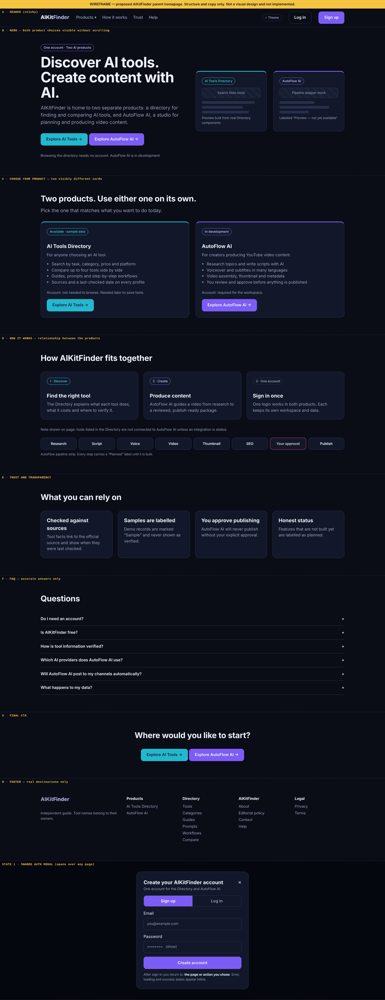

# Homepage Wireframe — Desktop (Phase 0A)

Proposed AIKitFinder **parent** homepage at 1024 px and wider. Structure and copy only; this is
not a visual design and nothing here is implemented.

**Rendered wireframe:** [`wireframes/homepage-wireframe-desktop.png`](wireframes/homepage-wireframe-desktop.png)
(source: [`wireframes/homepage-wireframe.html`](wireframes/homepage-wireframe.html))



Colour in the wireframe is functional only: violet marks parent and AutoFlow elements, cyan marks
Directory elements, yellow marks annotations.

## 1. Section order

| #   | Section                | Purpose                                               | Height target |
| --- | ---------------------- | ----------------------------------------------------- | ------------- |
| A   | Header                 | Brand, section links, theme, Log in, Sign up          | 68 px, sticky |
| B   | Hero                   | What AIKitFinder is; both product choices             | ≤ 1 screen    |
| C   | Choose your product    | Audience, purpose, account need, status, CTA for each | ≤ 1 screen    |
| D   | How it works           | How the products relate; AutoFlow pipeline strip      | ≤ 1 screen    |
| E   | Trust and transparency | Verification, sample labelling, approval, status      | ≤ 0.6 screen  |
| F   | FAQ                    | Six accurate answers                                  | ≤ 0.6 screen  |
| G   | Final CTA              | The two product choices again                         | ≤ 0.4 screen  |
| H   | Footer                 | Products, Directory, AIKitFinder, Legal               | —             |

Target total: about 4.5 screens at 1440×900 (the wireframe measures 3,738 px including two state
panels). Today's page is 13 screens.

## 2. Text wireframe

```
┌──────────────────────────────────────────────────────────────────────────────────────────┐
│ A  [AIKitFinder]   Products ▾   How it works   Trust   Help        (◐)  [Log in] [Sign up]│
├──────────────────────────────────────────────────────────────────────────────────────────┤
│ B                                                                                        │
│   ( One account · Two AI products )                 ┌────────────────┐ ┌────────────────┐│
│                                                     │ AI Tools       │ │ AutoFlow AI    ││
│   Discover AI tools.                                │ Directory      │ │                ││
│   Create content with AI.                           │ [ search mock ]│ │ [ pipeline    ]││
│                                                     │ ▬▬▬▬▬▬▬▬▬      │ │ ▬▬▬▬▬▬         ││
│   AIKitFinder is home to two separate products:     │ ▬▬▬▬▬▬▬        │ │ ▬▬▬▬▬▬▬▬▬      ││
│   a directory for finding and comparing AI tools,   │ cyan accent    │ │ violet accent  ││
│   and AutoFlow AI, a studio for planning and        │                │ │ "Preview — not ││
│   producing video content.                          │                │ │ yet available" ││
│                                                     └────────────────┘ └────────────────┘│
│   [ Explore AI Tools → ]  [ Explore AutoFlow AI → ]                                      │
│   Browsing the directory needs no account. AutoFlow AI is in development.                │
├──────────────────────────────────────────────────────────────────────────────────────────┤
│ C  Two products. Use either one on its own.                                              │
│    Pick the one that matches what you want to do today.                                  │
│   ┌───────────────────────────────────────┐  ┌───────────────────────────────────────┐   │
│   │ ( Available · sample data )           │  │ ( In development )                    │   │
│   │ AI Tools Directory                    │  │ AutoFlow AI                           │   │
│   │ For anyone choosing an AI tool.       │  │ For creators producing YouTube video. │   │
│   │ • Search by task, category, price     │  │ • Research topics and write scripts   │   │
│   │ • Compare up to four tools            │  │ • Voiceover and subtitles in many     │   │
│   │ • Guides, prompts, workflows          │  │   languages                           │   │
│   │ • Sources and a last-checked date     │  │ • Video assembly, thumbnail, metadata │   │
│   │ Account: not needed to browse.        │  │ • You approve before publishing       │   │
│   │ [ Explore AI Tools → ]                │  │ Account: required for the workspace.  │   │
│   │                                       │  │ [ Explore AutoFlow AI → ]             │   │
│   └───────────────────────────────────────┘  └───────────────────────────────────────┘   │
├──────────────────────────────────────────────────────────────────────────────────────────┤
│ D  How AIKitFinder fits together                                                         │
│   ┌ 1 · Discover ───────────┐ ┌ 2 · Create ─────────────┐ ┌ 3 · One account ─────────┐   │
│   │ Find the right tool     │ │ Produce content         │ │ Sign in once             │   │
│   └─────────────────────────┘ └─────────────────────────┘ └──────────────────────────┘   │
│   Tools listed in the Directory are not connected to AutoFlow AI unless stated.          │
│   [Research]→[Script]→[Voice]→[Video]→[Thumbnail]→[SEO]→[ YOUR APPROVAL ]→[Publish]      │
│   each step labelled "Planned" until built                                               │
├──────────────────────────────────────────────────────────────────────────────────────────┤
│ E  What you can rely on                                                                  │
│   [Checked against sources] [Samples are labelled] [You approve publishing] [Honest      │
│                                                                              status]     │
├──────────────────────────────────────────────────────────────────────────────────────────┤
│ F  Questions                                                                             │
│   Do I need an account?                                                              +   │
│   Is AIKitFinder free?                                                               +   │
│   How is tool information verified?                                                  +   │
│   Which AI providers does AutoFlow AI use?                                           +   │
│   Will AutoFlow AI post to my channels automatically?                                +   │
│   What happens to my data?                                                           +   │
├──────────────────────────────────────────────────────────────────────────────────────────┤
│ G              Where would you like to start?                                            │
│                [ Explore AI Tools → ]  [ Explore AutoFlow AI → ]                         │
├──────────────────────────────────────────────────────────────────────────────────────────┤
│ H  [AIKitFinder]      Products        Directory     AIKitFinder       Legal              │
│    Independent guide  AI Tools Dir.   Tools         About             Privacy            │
│                       AutoFlow AI     Categories    Editorial policy  Terms              │
│                                       Guides        Contact                              │
│                                       Prompts       Help                                 │
│                                       Workflows                                          │
│                                       Compare                                            │
└──────────────────────────────────────────────────────────────────────────────────────────┘
```

## 3. Section specifications

### A. Header

| Element      | Behaviour                                                             | Destination                       |
| ------------ | --------------------------------------------------------------------- | --------------------------------- |
| Logo         | Link                                                                  | `/`                               |
| Products ▾   | Menu button; opens on click and Enter; Escape closes; arrow keys move | Directory home · AutoFlow landing |
| How it works | In-page link                                                          | `#how-it-works`                   |
| Trust        | In-page link                                                          | `#trust`                          |
| Help         | In-page link now; Help Center later                                   | `#help`                           |
| Theme        | Existing toggle, persisted                                            | —                                 |
| Log in       | Opens the shared auth modal on the Log in tab                         | Modal                             |
| Sign up      | Primary button; opens the modal on the Sign up tab                    | Modal                             |

Signed-in state: Log in and Sign up are replaced by an account menu containing the product
switcher (AI Tools Directory, AutoFlow AI), Account, Log out.

No search field in the parent header: search belongs to the Directory.

### B. Hero

- **Kicker:** "One account · Two AI products" (shown once shared authentication is live; before
  that, "Two AI products").
- **Headline (h1):** "Discover AI tools. Create content with AI."
- **Supporting copy:** "AIKitFinder is home to two separate products: a directory for finding and
  comparing AI tools, and AutoFlow AI, a studio for planning and producing video content."
- **Primary actions:** "Explore AI Tools" (Directory accent) and "Explore AutoFlow AI" (AutoFlow
  accent), equal weight, side by side.
- **Status line:** "Browsing the directory needs no account. AutoFlow AI is in development."
- **Right side:** two preview panels, visibly different. The Directory panel is built from real
  Directory components (search field, a tool card). The AutoFlow panel shows a pipeline stepper
  and is labelled "Preview — not yet available" until a real workspace screen exists.
- No metrics, logos, ratings or testimonials.

Both CTAs must be visible without scrolling at 1024×768 and larger.

### C. Choose your product

Two cards that must not look like the same component with different text: different accent,
different preview, different status pill.

| Field        | AI Tools Directory                                  | AutoFlow AI                                     |
| ------------ | --------------------------------------------------- | ----------------------------------------------- |
| Status pill  | "Available · sample data" → "Available"             | "In development" → "Available"                  |
| Audience     | "For anyone choosing an AI tool."                   | "For creators producing YouTube video content." |
| Capabilities | Four bullets (see wireframe)                        | Four bullets, each true or labelled planned     |
| Account line | "Not needed to browse. Needed later to save tools." | "Required for the workspace."                   |
| CTA          | "Explore AI Tools" → Directory home                 | "Explore AutoFlow AI" → AutoFlow landing        |

The status pill text comes from configuration, not hard-coded copy, so it changes when the product
state changes.

### D. How it works

Three short cards (Discover, Create, One account), one explicit sentence that the products are
independent, and the AutoFlow pipeline strip. "Your approval" is a visually distinct step. Until
AutoFlow is built, each step carries a "Planned" label and the strip is static — no animated
progress, because nothing is running.

### E. Trust and transparency

Four statements. Each links to supporting detail: the editorial policy for the first two, the
AutoFlow landing page for the third. Statements that are not yet true are not shown (see the truth
check, section 3).

### F. FAQ

Native `<details>` disclosure, one open at a time not required. Six questions. Answers are in
`HOMEPAGE_CONTENT_TRUTH_CHECK.md` section 4.

### G. Final CTA

The two product buttons again. No "free" or "no sign-up" line.

### H. Footer

Real destinations only. No Deals. No Status link until a status page exists. Keeps the existing
independence disclaimer.

## 4. States

### Shared authentication modal

```
┌──────────────────────────────────────────────┐
│ Create your AIKitFinder account          [✕] │
│ One account for the Directory and AutoFlow AI│
│ ┌────────────┬────────────┐                  │
│ │  Sign up   │   Log in   │                  │
│ └────────────┴────────────┘                  │
│ Email     [                              ]   │
│ Password  [                       (show) ]   │
│ [            Create account              ]   │
│ You will return to: <the page you chose>     │
└──────────────────────────────────────────────┘
```

| State   | Behaviour                                                                                                        |
| ------- | ---------------------------------------------------------------------------------------------------------------- |
| Open    | Focus moves into the dialog; background is inert; title is announced                                             |
| Switch  | Sign up ⇄ Log in inside the same dialog; entered email is kept                                                   |
| Loading | Submit button shows progress and is disabled; fields stay readable                                               |
| Error   | Inline message next to the field or above the button; focus moves to it                                          |
| Success | Dialog closes; user continues to the originally requested page or action                                         |
| Closed  | Escape, the close button or a click outside; focus returns to the trigger; the visitor stays on the current page |

The modal never appears for a signed-in user.

### Other states

| Element           | Loading                                                       | Empty                                    | Error                              |
| ----------------- | ------------------------------------------------------------- | ---------------------------------------- | ---------------------------------- |
| Directory preview | Skeleton of the same size                                     | Static illustration with "Preview" label | Same static fallback               |
| Account menu      | Neutral placeholder; no flash of "Log in" for signed-in users | —                                        | Falls back to Log in / Sign up     |
| Status pills      | Rendered on the server                                        | —                                        | Default to the more cautious label |

## 5. Responsive behaviour (desktop range)

| Width        | Layout                                                                                                                                           |
| ------------ | ------------------------------------------------------------------------------------------------------------------------------------------------ |
| ≥ 1440 px    | 1200 px content width; hero in two columns; product cards side by side                                                                           |
| 1024–1439 px | Same structure; hero preview panels narrow; header links stay visible                                                                            |
| 768–1023 px  | Header collapses to the menu button; hero stacks (text, CTAs, then previews side by side); product cards side by side; trust cards in a 2×2 grid |

## 6. Accessibility notes

- One `h1`; each section has an `h2`; cards use `h3`.
- Landmarks: `header`, `nav`, `main`, `footer`; sections labelled by their headings.
- Skip link retained as the first focusable element.
- All targets at least 44 px high.
- Status is never colour-only: pills carry text; the approval step carries a label.
- Product accents are not the only difference between the two cards.
- Focus order follows reading order: header, hero CTAs, product cards, sections, footer.
- Reduced motion: no entrance animation; nothing is hidden awaiting animation.

## 7. Performance safeguards

- The parent homepage must not load GSAP, ScrollTrigger or any scroll-scene code.
- No WebGL, video or large images above the fold.
- Preview panels are HTML and CSS, not screenshots.
- Authentication code loads when the modal is first opened, not with the page.
- Entrance effects use the existing CSS classes (`enter`, `reveal`), which need no JavaScript.

## 8. Appendix — AutoFlow output-language controls (planning reference)

The v18 Phase 0A prompt asks that AutoFlow wireframes show separate output-language controls.
These belong to the AutoFlow workspace, not the homepage, and are recorded here so Phase 5 starts
from an agreed shape. Interface text stays English.

```
Script Generator                                   Voiceover & Subtitles
┌──────────────────────────────────────────┐       ┌──────────────────────────────────────────┐
│ AI provider   [ Claude            ▾ ]    │       │ Voice provider [ ElevenLabs       ▾ ]    │
│ Model         [ (from provider)   ▾ ]    │       │ Output language [ English         ▾ ]    │
│ Output language [ English         ▾ ]    │       │   loaded from the connected account      │
│   Choose the language for your           │       │ Model [ (models supporting language) ▾ ] │
│   generated script.                      │       │   limit: <n> characters per request      │
│                                          │       │ Voice [ (voices for this language)  ▾ ]  │
│ ⓘ Voiceover: available with ElevenLabs   │       │   ✓ Verified for English (accent)        │
│    — or —                                │       │   or: ⚠ Not verified for this language.  │
│ ⚠ Script only — no compatible            │       │      Pronunciation and accent may vary.  │
│    ElevenLabs voiceover model            │       │ Subtitles [ Same as script ▾ ]           │
└──────────────────────────────────────────┘       │   right-to-left preview where applicable │
                                                   │ Capabilities checked: <time> [Refresh]   │
                                                   │   stale data is marked "Last known"      │
                                                   └──────────────────────────────────────────┘
```

Rules carried from spec 22: no hard-coded language list; languages, models and voices come from
the connected account at runtime; English is the default; a language the LLM supports but no
speech model does is shown as "Script only"; if nothing is compatible, offer another provider or
audio upload and never fake a result.
